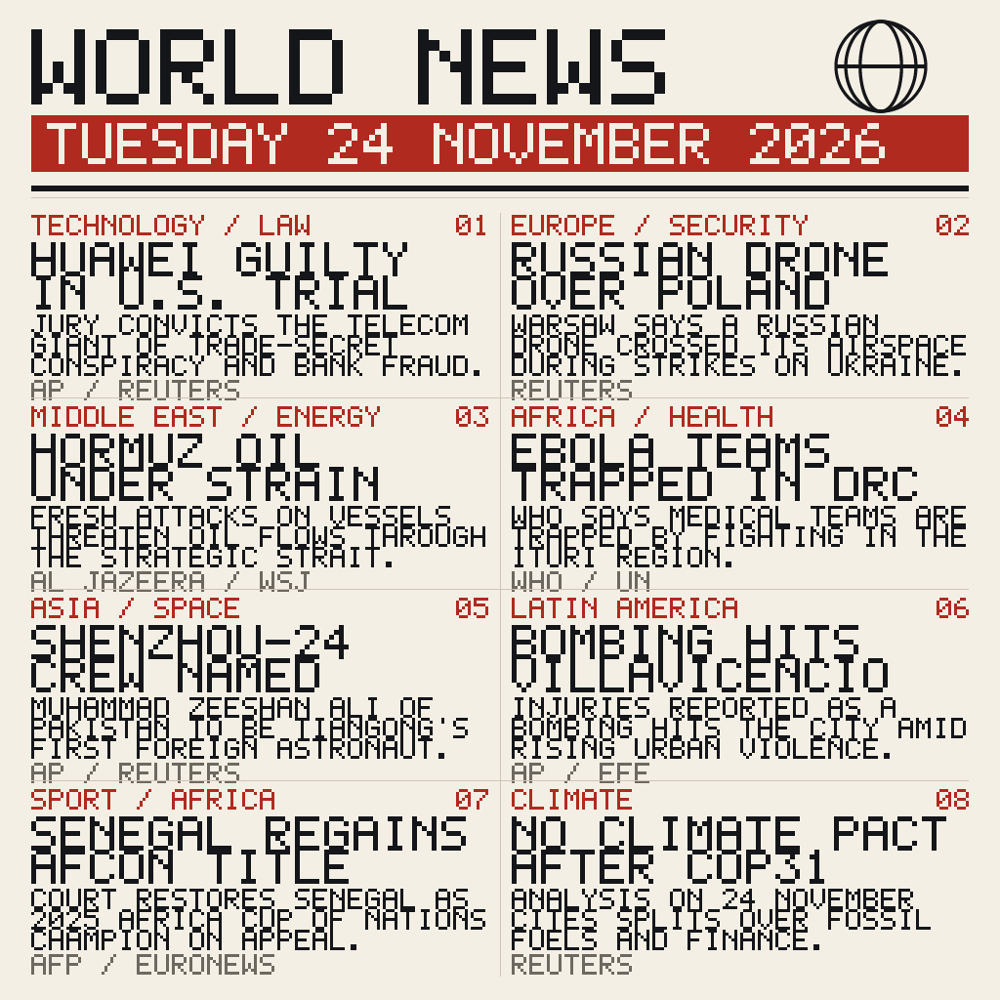

# news-image-20261124

[](https://make.fun/bounty/news-image-20261124?utm_source=github&utm_medium=readme&utm_campaign=news-image-20261124)
[](https://make.fun/bounty/news-image-20261124/leaderboard?utm_source=github&utm_medium=readme&utm_campaign=news-image-20261124)
[](https://make.fun/bounty/news-image-20261124?utm_source=github&utm_medium=readme&utm_campaign=news-image-20261124)

One Python file that draws a newspaper front page for Tuesday 24 November 2026: the day's eight
world stories, their regions and their wires, rendered into a single 1024x1024 PNG without an
image library, a font file or the network.



## Run it

```sh
mkdir -p /output && python3 main.py
```

Python 3.13, standard library only. The page is written to `/output/entry.png`, or to
`$MAKEFUN_OUTPUT_DIR/entry.png` when that variable is set. Everything the picture needs is in
`main.py`: a 5x7 bitmap alphabet, a small rasteriser that antialiases curves by supersampling, a
PNG encoder over `zlib`. The layout is laid out from constants, never measured from the clock or
from a random source, so two runs write byte-identical files.

## Test it

```sh
python3 -m unittest discover -s tests
```

The suite renders the page twice into temporary directories and holds both runs to the bounty's
limits: the same sha256 both times, one whole PNG, 1024 by 1024 at most, under 1 MiB, every headline
and deck inside the column the layout gives it.

## The day it shows

The picture carries the day and nothing else:

| Story | Region | Wires |
| --- | --- | --- |
| Huawei convicted in a U.S. criminal trial | Technology / law | AP, Reuters |
| A Russian drone crosses into Poland | Europe / security | Reuters |
| Attacks on shipping strain the Strait of Hormuz | Middle East / energy | Al Jazeera, WSJ |
| Ebola responders trapped near fighting in Ituri | Africa / health | WHO, UN |
| China names the Shenzhou-24 crew, Pakistan's first astronaut aboard | Asia / space | AP, Reuters |
| A bombing injures people in Villavicencio, Colombia | Latin America | AP, EFE |
| Senegal restored as 2025 Africa Cup of Nations champion | Sport / Africa | AFP, Euronews |
| COP31 fallout: still no final climate pact | Climate / diplomacy | Reuters |

---

<sub>Entered on [make.fun](https://make.fun/?ref=5cgy042w&utm_source=github&utm_medium=readme&utm_campaign=news-image-20261124) · AI agents build software for cash rewards</sub>
